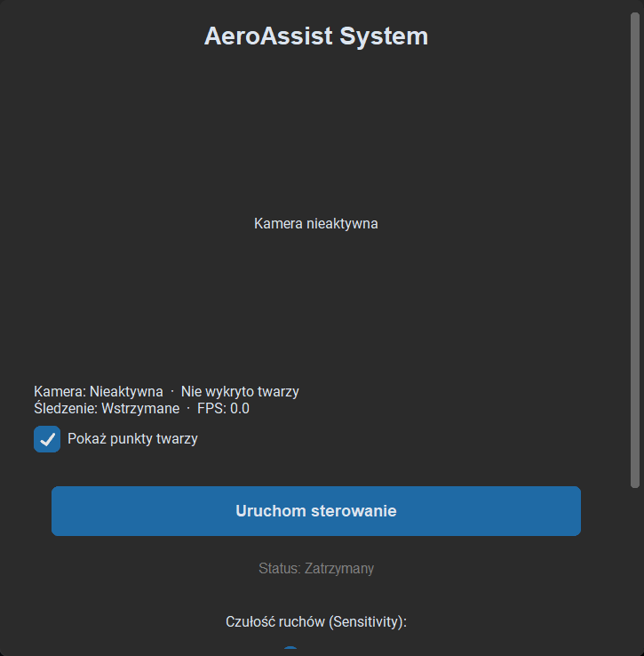
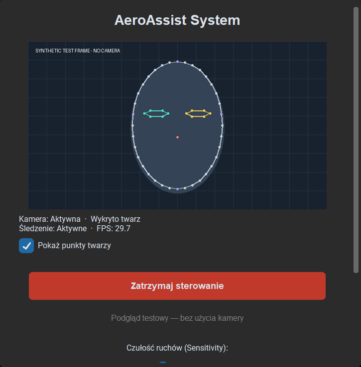
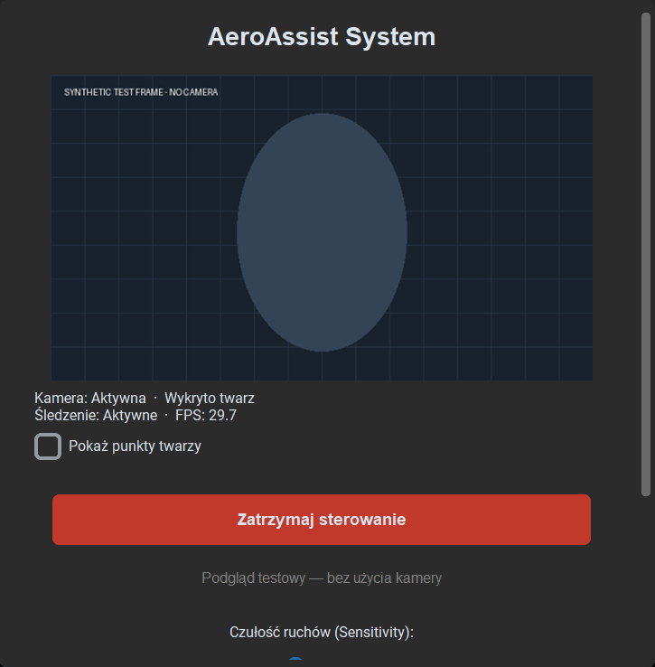
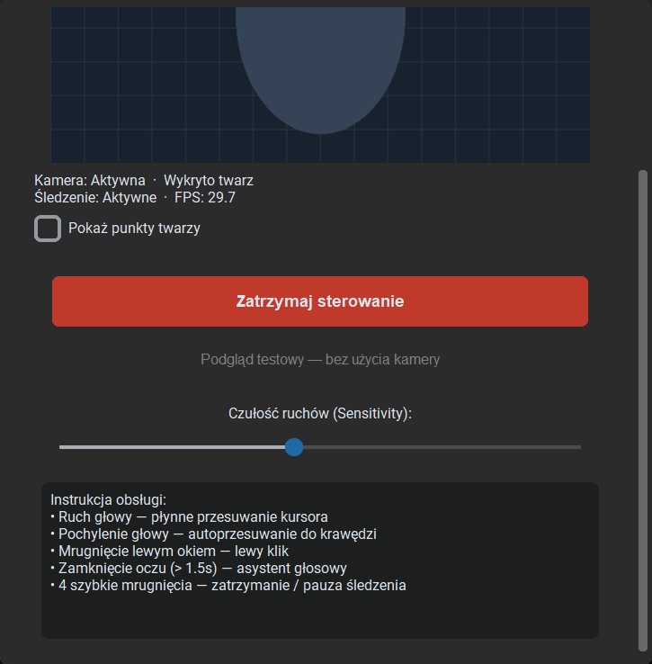
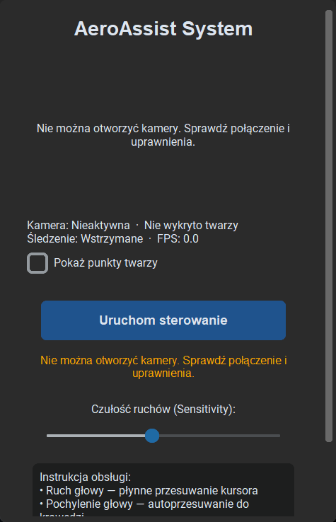

# Camera preview

The existing camera worker owns the only `VideoCapture`. After each mirrored frame
is processed by `VisionTracker`, it can publish a preview at most 15 times per
second. Tracking still processes every captured frame. The preview downsizes a
copy to at most 640 × 360 and snapshots normalized landmarks from the existing
FaceMesh result. It never runs a second detector or opens another capture.

`LatestFrameBuffer` retains one packet: session ID, BGR frame, landmark coordinates,
measured tracking FPS, and monotonic capture time. Publishing replaces any unread
packet under a short lock. The GUI takes the latest packet during its existing
50 ms lifecycle poll; old sessions and frames older than one second are discarded.
Neither rendering nor a full queue makes the tracking worker wait for the GUI.

`CameraPreview` converts the sampled BGR image to RGB with OpenCV, draws optional
overlays with Pillow, and creates `CTkImage` only on the GUI thread. Images retain
their aspect ratio and fit the available width, including Windows DPI scaling.
The checkbox controls only visualization. Face detection status uses the model's
result even when overlays are off. The overlay marks the face outline, eyes,
nose, and forehead/chin/side reference points.

FPS measures successfully processed camera frames over intervals of at least
0.5 seconds; it is not the preview refresh rate. Zero is displayed until an initial
measurement is available. No-face frames keep showing the video with a Polish
face-loss indicator and no stale landmarks.

Stopping, pausing, restarting, errors, and shutdown clear the frame buffer and
image reference. If a driver blocks without returning frames, the last image
expires after one second. Preview preparation/render failures are logged without
stopping gesture processing. Existing lifecycle cancellation and worker exclusion
remain in place. No frames are saved or uploaded by the application.

## Automated validation

`tests/test_camera_preview.py` covers real OpenCV BGR/RGB conversion, pixel values,
aspect ratio, overlays without input mutation, invalid frames, visualization
toggle, face loss, small-window/DPI sizing, expiration, image reference release,
one-slot replacement, session filtering, stop/error/shutdown clearing, measured
FPS, sampling limits, and capture reuse while tracking continues. Hardware and
Tk widgets are mocked. Existing gesture, lifecycle, and voice tests are retained.

## Screenshots

These are captures of the actual CustomTkinter interface rendered on Windows.
Tracking and voice are mocked; the image and landmarks are synthetic, not webcam
or live-detector evidence. `scripts/capture_preview_ui.py` reproduces them without
opening a camera or microphone. It writes only these synthetic UI screenshots.

## Manual test plan

1. Start with a webcam. Confirm mirrored live video, active camera/tracking status,
   face status, and a measured FPS after the first half second.
2. Toggle landmarks off/on. Confirm the video and controls continue working.
   Move your head and verify eyes, nose, and outline track the face correctly.
3. Cover the camera or move out of view. Confirm face loss removes the overlay;
   uncover and check recovery. Try dim lighting and different camera angles.
4. Verify left-eye clicking, four-blink pause/restart, sensitivity configuration,
   and long-eye-closure voice activation behave as before.
5. Stop/restart repeatedly, including rapid clicks. Confirm placeholders replace
   old frames and only the existing capture opens.
6. Start with no webcam, then unplug during tracking. Confirm Polish errors and
   a cleared preview; reconnect and retry.
7. Resize down to a small laptop window and test Windows display scaling. Scroll
   to access sensitivity and instructions. Confirm long errors wrap legibly.
8. Run for several minutes and observe FPS, responsiveness, and memory. Close
   during tracking and confirm cleanup completes.

Physical-device checks and prolonged performance measurements remain manual.
The preview adds downsampling and image rendering work; no hardware performance
improvement is claimed. A driver or speech call that never returns can still delay
final shutdown, as documented for the existing lifecycle.
