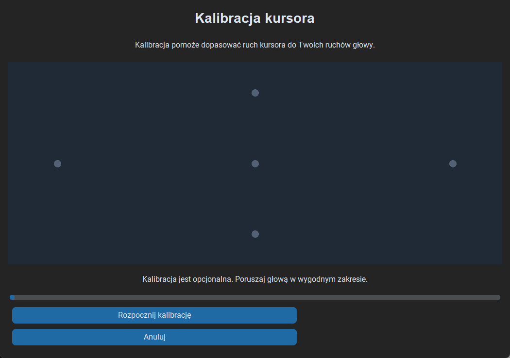
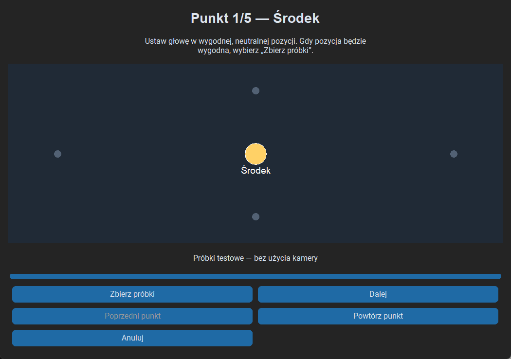
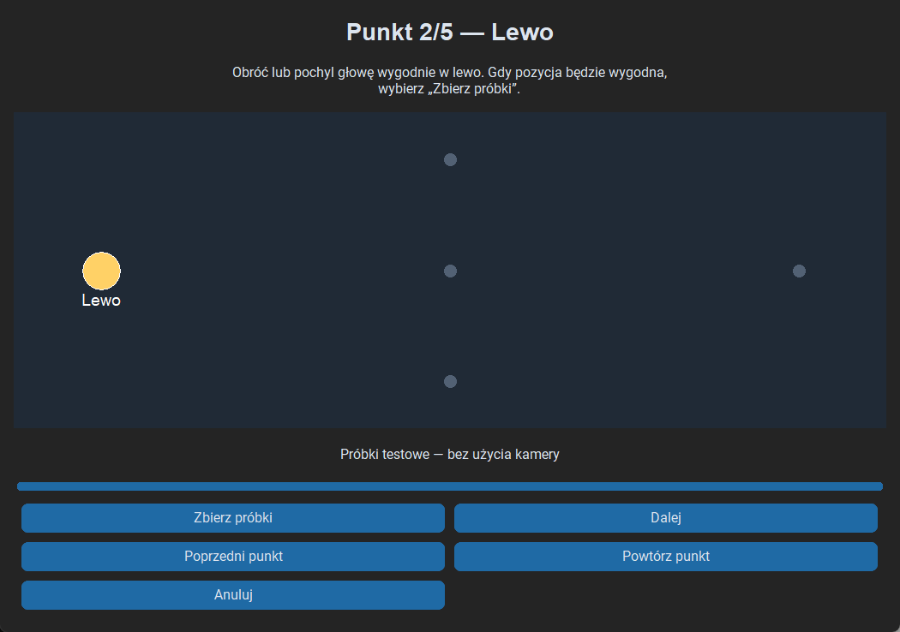
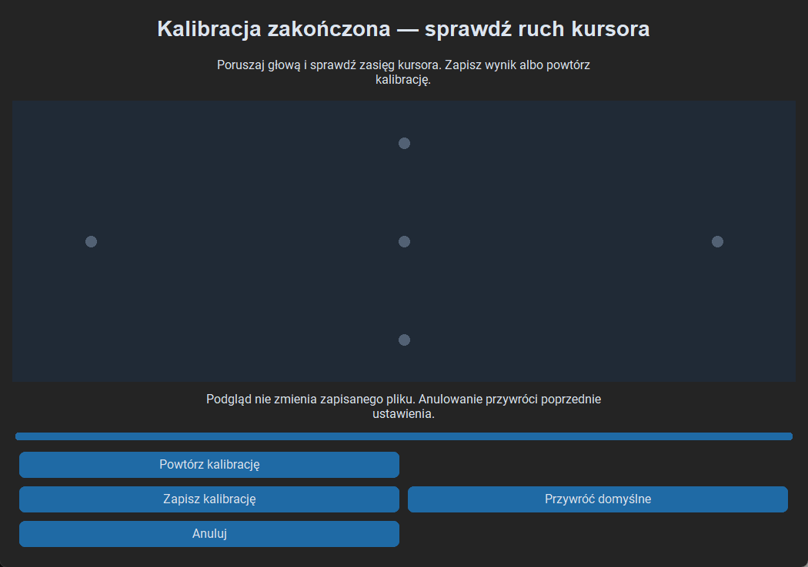

# Optional five-point head calibration

Open **Kalibracja kursora → Rozpocznij kalibrację**. The wizard describes head
movement, then guides the user through center, left, right, top, and bottom. For
each point, assume a comfortable position and explicitly choose **Zbierz próbki**.
After collection, choose **Dalej** or repeat that point. **Poprzedni punkt** allows
earlier measurements to be redone without restarting all five points.

The wizard uses the existing tracking session or starts it through the normal
start/stop path. It never opens another camera or detector. Cursor positioning is
held only while collecting samples, so head control remains available between
points; eye-gesture mappings and voice integration remain active.
Four-blink pause still stops tracking. Resuming collection uses the normal worker
lifecycle. The wizard's buttons support Tab, Shift+Tab, Enter, Space, and Escape.

## Samples and quality

`VisionTracker` exposes normalized nose coordinates from its existing FaceMesh
result, including a missing-face value. While the wizard is open, the camera
worker publishes a session-tagged `HeadSample` into a one-slot buffer. The GUI's
existing 50 ms poll consumes it. Stale/previous-session data cannot fill the wizard.
No Tk APIs are called by the worker.

`CalibrationManager` keeps a rolling window of **20 distinct samples** per point.
Coordinates must be finite, numeric, and between 0 and 1. The median is used for
each axis; every sample must be within **0.01 normalized units** of that axis's
median. An unstable window waits for stable measurements rather than accepting
a single frame. Face loss clears the current window. Missing frames clear the
window after one second; collecting for ten seconds without completing a stable
window stops the attempt and offers a retry. These constants are in
`core/calibration.py`.

The center supplies the neutral x/y. Left/right medians supply horizontal endpoints;
top/bottom medians supply vertical endpoints. Each directional range must be at
least **0.01** away from the neutral axis, in the expected direction. Missing
points, nonfinite values, reversed directions, and insufficient ranges are rejected.
Previously saved parameters remain intact if collection/calculation fails.

## Mapping and compatibility

Mapping is piecewise linear and asymmetric on each axis: neutral maps to the
screen center, and the measured comfortable endpoints map to the corresponding
screen edges at default sensitivity 1.9. Current sensitivity supplies the same
gain ratio as the default controller. Gain may require greater movement at low
sensitivity. Mapping is clamped, then passes through the existing dead zone, EMA,
maximum step, and screen boundary checks. Newly reached boundary coordinates
bypass the dead zone so the final edge pixel remains reachable.

Applying or removing calibration resets filter history. The first valid sample
holds the last commanded position, and subsequent samples approach the calibrated
absolute target through EMA and the step limit. Pausing, restarting, or losing a
face clears movement history but preserves calibration parameters. Disabling
calibration restores the existing nonlinear/tilt mapping.

After all five points, the candidate is applied for **temporary preview**. No file
is changed until **Zapisz kalibrację**. Cancel/closing the wizard restores the
previous active mapping. Repeating starts a fresh measurement session. Save
failure restores the previous mapping and keeps the candidate available for retry.
Restore defaults removes the saved calibration; failure to remove it does not
change the saved or active profile. Smoothing settings are separate from calibration.

## Local JSON storage

On Windows the path is `%LOCALAPPDATA%\AeroAssist\calibration.json`. A non-Windows
fallback is `~/.config/AeroAssist/calibration.json`. Data is a versioned object:

```json
{
  "version": 1,
  "parameters": {
    "center_x": 0.5,
    "center_y": 0.5,
    "left_x": 0.4,
    "right_x": 0.65,
    "top_y": 0.35,
    "bottom_y": 0.7
  }
}
```

Only six calculated normalized parameters are stored. There are no raw samples,
frames, images, identifiers, or cloud/database writes. A temporary file in the same
directory is replaced atomically before the active committed profile changes.
Startup validates version, schema, size (maximum 4 KiB), numbers and directional
ranges. Missing, corrupt, incompatible, or unreadable files fall back safely and
log technical errors. Restore defaults deletes the JSON file so defaults also
apply after restart. The system supports one local calibration, not user profiles.

## Validation and screenshots

Automated tests cover medians, stability, invalid/insufficient samples, directional
ranges, mapping/clamping, atomic save/load failures, corrupt JSON, restoration,
EMA/sensitivity compatibility, all four corners, wizard steps/retry/cancel/save,
tracking loss, keyboard control logic, single-capture reuse, and preserved gesture
callbacks while collecting. Hardware and mouse automation are mocked.

The Windows GUI smoke check runs a real CustomTkinter wizard with synthetic head
samples and temporary JSON storage. It checks keyboard activation, five-point
progression, preview, and save. Screenshots below show that synthetic run, not
webcam or physical-accessibility verification. Reproduce them with
`python scripts/capture_calibration_ui.py` from the project virtual environment.






## Manual test plan and limits

1. Complete all five points using a real webcam, keeping each head position
   comfortable. Repeat an individual point and navigate backwards once.
2. Test preview, reach all four screen corners, and adjust smoothing/sensitivity.
   Cancel once and verify the previous mapping returns; repeat and save.
3. Restart the application and verify the saved mapping loads. Restore defaults,
   restart again, and verify the original mapping is used.
4. Repeat from a different sitting position or with limited movement. Try ranges
   below the minimum and verify the existing saved calibration survives failure.
5. Move out of frame, pause with four blinks, unplug the camera, and retry a point.
   Confirm no stale samples complete it and no second capture is opened.
6. Test all controls by keyboard, including cancel before completion. Check a
   smaller window and Windows display scaling.
7. Verify eye click, long-eye-closure voice activation, preview, and shutdown.

Physical-camera accuracy, limited-mobility comfort, and prolonged use remain
unverified. This is head-position calibration, not gaze estimation. Independent
axis mapping cannot model camera rotation or cross-axis coupling; moving the
camera or changing posture can require recalibration. The one-second/ten-second
thresholds may require retries on very slow cameras. The wizard covers the
available window area with directional reference points; it does not infer eye
fixation. Current primary-screen, last-commanded-position, frame-rate, and
camera/speech blocking limitations remain as previously documented.
